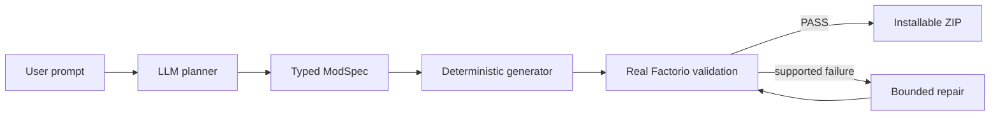

# Factorio AI Modding Pipeline

**From a natural-language request to a validated Factorio mod ZIP.**

[](https://github.com/arttvad9r/modding-mvp/actions/workflows/ci.yml)
[](LICENSE)
[](https://www.typescriptlang.org/)
[](https://www.factorio.com/)

This repository is an end-to-end prototype for AI-assisted game mod generation. A constrained planner turns a prompt into a typed `ModSpec`, deterministic code generation produces the mod, a real pinned Factorio runtime validates it, and a bounded repair loop can fix supported failures before an installable ZIP is returned.



## What this project demonstrates

- **Constrained AI planning** behind a provider-neutral LLM boundary rather than free-form code generation.
- **Deterministic generation** from an allow-listed typed specification.
- **Real-game verification** against a pinned Factorio 2.0.77 Linux headless runtime.
- **Bounded repair** with preserved semantic assertions and hard retry limits.
- **Production-shaped backend work**: PostgreSQL/pg-boss jobs, S3-compatible private artifacts, worker heartbeats, authentication, rate limits, telemetry and Docker deployment.
- **Evidence-driven development** through golden planner evals, integration tests and live end-to-end runs.

## Current status

Milestones M0–M5 are complete: real-game harness, typed ModSpec engine, expanded capabilities, natural-language planner, repair loop and local prompt-to-ZIP pipeline. M6 is an active private-beta service with API/worker lifecycle, PostgreSQL queueing, S3-compatible artifacts, tester UI and a production-like deployment. Public tester ingress and recruitment remain intentionally unfinished.

The public product name is intentionally undecided; the repository name reflects its prototype origin.

## Documentation
Start with [`docs/README.md`](docs/README.md).

Key documents:
- [`docs/product-spec.md`](docs/product-spec.md) — product specification;
- [`docs/technical-spec.md`](docs/technical-spec.md) — technical specification;
- [`docs/architecture.md`](docs/architecture.md) — current architecture;
- [`docs/roadmap.md`](docs/roadmap.md) — milestone plan;
- [`docs/backlog.md`](docs/backlog.md) — actionable engineering backlog;
- [`docs/capabilities.md`](docs/capabilities.md) — Factorio capability registry;
- [`docs/service-contract.md`](docs/service-contract.md) — private-beta API/worker contract;
- [`docs/deployment.md`](docs/deployment.md) — private-beta build/deployment runbook;
- [`docs/adr/README.md`](docs/adr/README.md) — architecture decision records.
- [`CONTRIBUTING.md`](CONTRIBUTING.md) — contribution and verification rules;
- [`SECURITY.md`](SECURITY.md) — security boundaries and reporting.

AI coding agents must also follow [`AGENTS.md`](AGENTS.md).

## Setup

```bash
pnpm install
pnpm factorio:setup
pnpm postgres:setup
```

The setup scripts install the pinned Factorio 2.0.77 headless runtime and build PostgreSQL 18.6 for local M6 integration tests under git-ignored `.tools/`; both source archives are checksum-verified. The PostgreSQL runtime is a dev/test dependency, not a production deployment prescription.

Docker-backed M6 service integration uses pinned `postgres:18.6-alpine3.24` plus `adobe/s3mock:5.2.3`. The compose credentials are fixed local-test values only and must never be reused for deployment.

## Checks

```bash
pnpm typecheck
pnpm test
pnpm test:integration
pnpm test:service-integration
pnpm build
```

## Test a mod manually

```bash
pnpm factorio:test -- /absolute/or/relative/path/to/mod
```

A successful run prints structured `PASS`; a Factorio load failure prints structured `FAIL` with a normalized error summary.

## Build a deterministic mod

```bash
pnpm mod:build -- examples/faster-steel-furnace.json dist
pnpm mod:build -- examples/cheaper-iron-gears.json dist
pnpm mod:build -- examples/double-automation-research-cost.json dist
pnpm mod:build -- examples/remove-steel-prerequisite.json dist
```

The examples cover a prototype scalar property, an existing recipe item ingredient amount, a finite technology research-unit count, and a reviewed technology prerequisite edit. The command validates the ModSpec, generates only allow-listed files in a temporary build directory, runs Factorio plus semantic assertions, and writes an installable ZIP only after validation passes.
## Plan a natural-language request

Planner runtime selection is configuration-only. Keep API keys in the environment, never in repository files; `.env.example` lists the supported variables.

Ollama Cloud test run:

```bash
LLM_PROVIDER=ollama-cloud \
OLLAMA_API_KEY=... \
pnpm prompt:plan -- "Make steel furnaces twice as fast"
```

Z.ai general/prepaid API test run:

```bash
LLM_PROVIDER=zai \
ZAI_API_KEY=... \
pnpm prompt:plan -- "Make steel furnaces twice as fast"
```

For a Z.ai Coding Plan API key, additionally set `ZAI_API_MODE=coding`; the project then uses the coding-only base URL instead of the general API URL. OpenAI remains available with `LLM_PROVIDER=openai`, `OPENAI_API_KEY`, and `OPENAI_MODEL`.

The current dev/eval defaults are `glm-5.3-flash` for both Ollama Cloud and Z.ai. The beta worker production routing is Ollama Cloud `glm-5.3-flash` primary with Z.ai Coding Plan `glm-5.3-flash` as provider-level fallback; both the normal Ollama path and a forced fallback smoke are verified on the deployed worker image. Local CLI/eval commands still select one provider with `LLM_PROVIDER`. Override a model with `LLM_MODEL` (or the provider-specific model variable).

`prompt:plan`, `prompt:build`, `planner:eval`, and `repair:eval` automatically load a git-ignored `.env.local` from the repository root when it exists. This is the preferred local-key workflow; copy `.env.example` to `.env.local`, add only local credentials, and never commit the file.

The same provider configuration runs the golden Planner corpus:

```bash
LLM_PROVIDER=ollama-cloud OLLAMA_API_KEY=... pnpm planner:eval
LLM_PROVIDER=zai ZAI_API_KEY=... pnpm planner:eval
```

The default eval gates are 90% classification accuracy and 80% exact supported-ModSpec semantic accuracy. Recorded baselines: Ollama Cloud `deepseek-v4.1-flash:cloud` = 100% / 100% on the corpus; Z.ai Coding Plan `glm-5.3-flash` = 100% classification (24/24) and 100% supported ModSpec accuracy (12/12), 53,822 total tokens. The earlier Z.ai 429 was caused by using the general endpoint with a Coding Plan key; Coding Plan uses `https://api.z.ai/api/coding/paas/v4`.

Run the M4 Repair regression corpus against real Factorio with:

```bash
LLM_PROVIDER=zai ZAI_API_MODE=coding pnpm repair:eval
```

Repair never changes the accepted ModSpec, `info.json`, or semantic assertions; the model may replace only `data.lua`. Z.ai Coding Plan `glm-5.3-flash` repairs 5/5 injected load/semantic failures with 5 total attempts.

## Private-beta service commands

The service backend now has separate migration, worker, API/UI, and beta-user provisioning commands:

```bash
DATABASE_URL=... pnpm db:migrate
DATABASE_URL=... pnpm beta:user:create -- "Tester label"
DATABASE_URL=... pnpm beta:user:create -- --internal "Deployment smoke"
DATABASE_URL=... pnpm beta:user:create -- --internal "Deployment smoke"
DATABASE_URL=... pnpm beta:kpis
pnpm worker:start
pnpm web:start
```

`beta:user:create` prints the opaque access token only when it is created; only its SHA-256 hash is persisted. Use `--internal` for deployment/smoke accounts so their generations, feedback, and WTP responses are excluded from product KPI reporting. `web:start` serves the tester UI at `/` and the authenticated `/v1` API from the same origin. Required PostgreSQL, S3, LLM, Factorio, and API security environment variables are listed in `.env.example`. The beta token entered in the UI is kept only in the current browser tab's `sessionStorage`.

For a reproducible backend regression using Docker PostgreSQL + S3Mock and real Factorio, run `pnpm test:service-integration`. This does not replace the required smoke against the eventual hosted S3-compatible provider.

Deployment packaging can be checked with `pnpm test:container-images`. The provider-neutral `infra/Dockerfile` has separate `web` and `worker` targets; the worker image downloads the checksum-pinned official Factorio headless archive at startup into `/app/.tools` rather than embedding the game binary. `infra/compose.beta.yaml` captures the first VPS topology with pinned PostgreSQL + SeaweedFS and persistent volumes; `pnpm test:beta-compose` checks its deployment-critical invariants. Run `pnpm s3:smoke` (or the compiled container command in `docs/deployment.md`) against the actual hosted bucket before beta exposure.

## Build from a natural-language prompt

```bash
pnpm prompt:build -- "Make steel furnaces twice as fast"
```

The command streams bounded progress to stderr, prints a structured terminal result to stdout, writes the installable ZIP under `dist/` only after real Factorio validation succeeds, and stores a git-ignored run report under `.runs/<generation-id>.json`. If Factorio returns a repair-eligible load/semantic failure, the same command invokes bounded Repair automatically.

Record local feedback with:

```bash
pnpm prompt:feedback -- <generation-id> up "Installed successfully"
```

The recorded M5 live smoke with Z.ai `glm-5.3-flash` completed prompt → Planner → generation → Factorio → ZIP in 5.4 seconds using one Planner attempt and 2,215 model tokens; no Repair was required.

## Private-beta service integration

Run the Docker-backed infrastructure path with:

```bash
pnpm test:service-integration
```

The command starts isolated PostgreSQL + S3Mock containers, verifies S3 upload/presigned download, then exercises atomic generation submission through pg-boss and the executable worker using real Factorio. The integration Planner is a typed fake provider so infrastructure tests do not consume external LLM quota. The wrapper removes containers and volumes when the command exits.

Run the real worker with deployment environment variables from `.env.example` using:

```bash
pnpm worker:start
```

## Private-beta API

Apply versioned service migrations, provision a tester, then run API and worker as separate processes:

```bash
DATABASE_URL=... pnpm db:migrate
DATABASE_URL=... pnpm beta:user:create -- "Tester label"
DATABASE_URL=... S3_BUCKET=... API_IP_HASH_SALT=... pnpm api:start
DATABASE_URL=... S3_BUCKET=... LLM_PRIMARY_PROVIDER=ollama-cloud LLM_FALLBACK_PROVIDER=zai pnpm worker:start
```

`beta:user:create` prints the high-entropy bearer token once; only its SHA-256 hash is stored. The implemented endpoints are `POST /v1/generations`, `GET /v1/generations/:id`, `POST /v1/generations/:id/feedback`, and `GET /v1/generations/:id/download`. Generation work always stays in the worker.

`pnpm test:service-integration` now proves the complete Docker-backed HTTP path with fake typed Planner output and real Factorio, so it does not spend external LLM quota.
